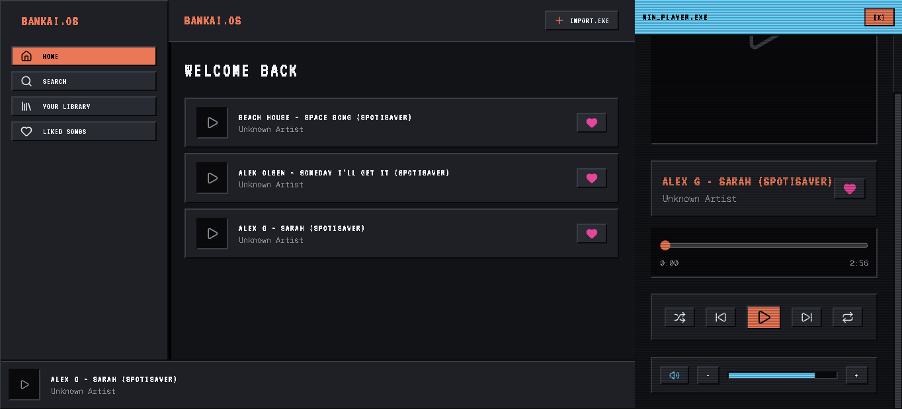
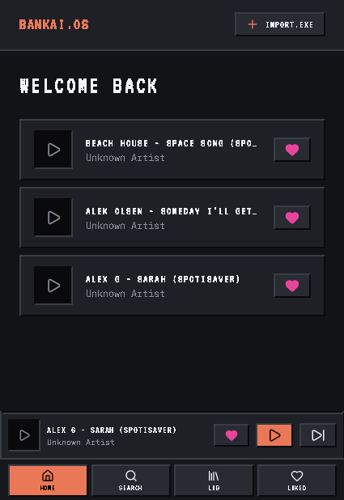

# BANKAI.OS // Retro PWA Music Player 📼

Bankai adalah aplikasi pemutar musik modern bertema **Midnight Retro OS / Cyberpunk CRT** terinspirasi dari filosofi desain Poolsuite. Berjalan sepenuhnya secara lokal dan offline sebagai Progressive Web App (PWA).

---

## 📸 Preview Tampilan

### 🖥️ Desktop Version


### 📱 Mobile Version
<p align="center">
  
</p>

---

## ✨ Fitur Utama

- **Estetika Midnight Retro OS**: Desain antarmuka 80s/90s dengan *bevel 3D*, CRT scanline, pixel font (`VT323`), dan aksen palet *Cyber Neon Orange* (`#FF7A59`) serta *Electric Aqua* (`#00D2FF`).
- **100% Offline & Lokal**: Simpan file audio secara lokal di peramban menggunakan IndexedDB via `idb`. Tanpa ketergantungan server atau internet.
- **PWA Ready**: Dapat diinstal di desktop atau perangkat mobile dengan dialog retro installer kustom.
- **Spotify-style Controls**: Kontrol volume cepat (`+` / `-` / Mute), toggle repeat, shuffle, scrubber slider dengan visualizer audio retro.
- **Media Session API**: Terintegrasi langsung dengan kontrol media notifikasi sistem operasi / lockscreen ponsel.
- **Ekstraksi Metadata Otomatis**: Membaca otomatis judul, artis, dan cover art dari metadata ID3 file MP3/FLAC/WAV lokal via `music-metadata-browser`.

---

## 🛠️ Tech Stack

- **Framework**: React 19 + TypeScript
- **Bundler**: Vite 8 + `@vitejs/plugin-react`
- **PWA**: `vite-plugin-pwa` + Workbox
- **Styling**: Tailwind CSS v4 + `@fontsource/vt323` + `@fontsource/geist-mono`
- **Animasi**: Framer Motion
- **Database Lokal**: IndexedDB (`idb`)
- **Metadata Parser**: `music-metadata-browser`
- **Icons**: Lucide React

---

## 🚀 Memulai Proyek

### Prasyarat
- Node.js (v18+)
- npm atau pnpm/yarn

### Instalasi & Menjalankan Dev Server

```bash
# Masuk ke direktori bankai
cd bankai

# Install dependencies
npm install

# Jalankan server pengembangan
npm run dev
```

Buka URL lokal yang muncul di terminal (biasanya `http://localhost:5173`).

### Build untuk Produksi

```bash
npm run build
```

Hasil build dan service worker PWA akan digenerate ke dalam folder `dist/`.

---

## 📁 Struktur Direktori

```text
bankai/
├── public/              # Aset statis & manifest PWA
├── screenshots/         # Dokumentasi tampilan UI (Desktop & Mobile)
├── src/
│   ├── assets/          # Ikon & grafis tambahan
│   ├── components/      # Komponen UI retro (Sidebar, MiniPlayer, FullScreenPlayer, dll)
│   ├── hooks/           # Custom hook (usePWAInstall, useMediaSession)
│   ├── lib/             # Konfigurasi IndexedDB lokal
│   ├── store/           # AudioContext & State Management
│   ├── App.tsx          # Main View & routing state
│   ├── index.css        # Bevel 3D, Scanline, & Styling Retro
│   └── main.tsx         # Entry point aplikasi
├── package.json
└── vite.config.ts
```
